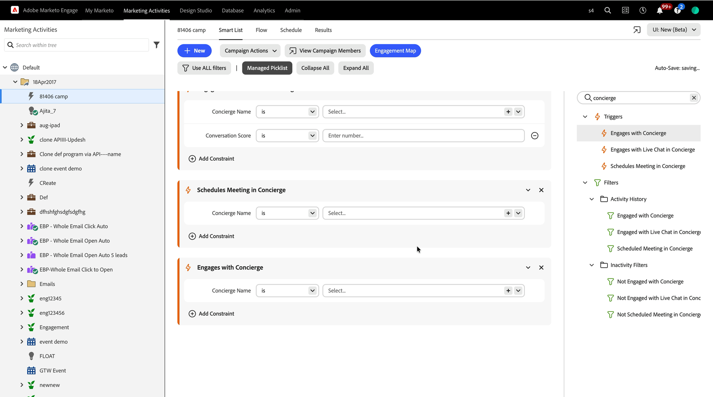

# Dados do Brand Concierge no Marketo Engage {#marketo-activities}

Quando [!DNL Adobe Marketo Engage] está conectado, cada visitante que preenche um formulário, agenda uma reunião ou inicia um chat ao vivo se torna um registro de pessoa em [!DNL Marketo], e seu compromisso de concierge é gravado nesse registro como tipos de atividade nativa. Isso significa que você pode criar Smart Lists e Campanhas inteligentes no comportamento de concierge exatamente como faria em qualquer outra atividade [!DNL Marketo].

>[!NOTE]
>
>As próprias reservas de chat ao vivo e reunião não exigem [!DNL Marketo Engage]. Sem ele, os dados descritos nesta página permanecem em [!DNL Adobe Marketo Qualifier]. Consulte [Visão geral do chat ao vivo e da reserva de reunião](overview.md#prerequisites).

## Criação de clientes potenciais e atribuição de origem {#lead-creation}

Uma pessoa criada por meio de um concierge recebe as tags para que você sempre possa saber de onde ela veio.

| Campo | Valor |
| --- | --- |
| **[!UICONTROL Source de pessoas]** | `Brand Concierge` |
| **[!UICONTROL Tipo de Source Original]** | `Chat` |
| **[!UICONTROL Informações Originais do Source]** | `Concierge` |
| **[!UICONTROL Tipo de Source de Registro]** | `Chat` |
| **[!UICONTROL Informações de Source de Registro]** | `Concierge` |

{width="800" zoomable="yes"}

## Tipos de atividades {#activity-types}

Três tipos de atividades nativas são encaminhadas para o registro de pessoa. Todos os três estão disponíveis como acionadores e filtros.

{width="800" zoomable="yes"}

### Interagir com o Concierge {#engage-with-concierge}

Registrado quando um visitante interage com o concierge.

| Atributo | Descrição |
| --- | --- |
| Nome do concierge | O concierge com o qual o visitante se envolveu |
| ID da conversa | O identificador da conversa. Usar no Composer para abrir a transcrição completa |
| URL da página | A página onde o compromisso aconteceu |
| Criado em | Quando a conversa foi criada |
| Duração | Quanto tempo durou a conversa |

>[!NOTE]
>
>Alguns atributos neste tipo de atividade, incluindo tópicos discutidos, resumo e idioma, ainda não estão preenchidos. Eles estão planejados para uma versão futura.

### Agendar Reunião no Concierge {#schedule-meeting}

Registrou **duas vezes** para uma única reserva, que é o que permite separar a intenção do resultado.

**Primeiro, na iniciação.** O visitante selecionou a opção para agendar uma reunião e o formulário de reserva apareceu. O status da reunião é `Started`.

| Atributo | Descrição |
| --- | --- |
| Status da reunião | `Started` |
| URL da página | A página onde o visitante iniciou a reserva |
| ID do Concierge | O concierge com o qual o visitante se envolveu |
| ID de pessoa | O registro da pessoa [!DNL Marketo] |

**Em seguida, na reserva.** O visitante confirmou um slot. O status da reunião é `Scheduled`.

| Atributo | Descrição |
| --- | --- |
| Status da reunião | `Scheduled` |
| Nome do Representante de Vendas | O representante com quem a reunião foi agendada |
| E-mail do representante de vendas | O endereço de email do representante |
| Agendado para | A data e a hora da reunião |
| Duração da Reunião | A duração da reunião reservada |
| Tipo de roteamento | O roteiro que resolveu o calendário deste representante |
| URL da página | A página onde o visitante reservou |
| ID do Concierge | O concierge com o qual o visitante se envolveu |
| ID de pessoa | O registro da pessoa [!DNL Marketo] |

>[!TIP]
>
>Criar uma Smart List em `Meeting Status` é `Started`, mas não `Scheduled` para localizar todos que começaram a marcar uma reunião e a abandonaram. Essa é uma audiência pronta para ser nutrida ou redirecionada.

### Interagir com o bate-papo ao vivo no Concierge {#engage-with-live-chat}

Registrado após o término de um chat ao vivo.

| Atributo | Descrição |
| --- | --- |
| Status da conversa | `Ended` se o chat foi fechado deliberadamente, `Dropped` se o visitante saiu do site e o chat expirou |
| Agentes notificados | Os endereços de email de cada agente que foi notificado deste chat |
| Pontuação da conversa | A classificação de 0 a 3 que o representante deu à conversa. Consulte [Pontuar a conversa](chat-inbox.md#conversation-score) |
| URL da página | A página onde o chat ao vivo foi iniciado |
| ID do Concierge | O concierge com o qual o visitante se envolveu |
| ID da sessão | O identificador de sessão do chat ao vivo |
| Hora de início | Quando o chat começou |

>[!TIP]
>
>A pontuação da conversa é o atributo de valor mais alto aqui, porque um humano que realmente falou com o visitante o definiu. Use-o para pontuação de lead, redirecionamento, personalização e entrega para vendas e CRM.

## Usar dados de concierge em uma campanha inteligente {#smart-campaign}

Em uma **[!UICONTROL Smart List]** da Campanha Inteligente, procure `concierge` para ver tudo o que está disponível.

{width="800" zoomable="yes"}

| Categoria | Itens disponíveis |
| --- | --- |
| **[!UICONTROL Triggers]** | Engaja com o Concierge, Engaja com o Bate-papo ao vivo no Concierge, Agenda Reunião no Concierge |
| **[!UICONTROL Filtros]** > Histórico de atividades | Envolvido com o Concierge, Envolvido com o Bate-papo ao vivo no Concierge, Reunião agendada no Concierge |
| **[!UICONTROL Filtros]** > Filtros de inatividade | Não Envolvido com o Concierge, Não Envolvido com o Bate-papo ao vivo no Concierge, Não Agendado Reunião no Concierge |

Arraste um gatilho ou filtro para a tela e selecione **[!UICONTROL Adicionar Restrição]** para estreitá-la.

### Restrições {#constraints}

| Acionar ou filtrar | Restrições |
| --- | --- |
| Envolvido com o Concierge | Nome do concierge, URL da página, Criado em, Duração, Data da atividade |
| Reunião agendada no Concierge | Nome do Atendimento, Nome do Representante de Vendas, Status da Reunião, Agendado para, Duração da Reunião, Tipo de Encaminhamento, URL da Página, Data da Atividade |
| Engajado com o bate-papo ao vivo no Concierge | Nome do Atendimento, Nome do Representante de Vendas, Status da Conversa, Pontuação da Conversa, Hora de Início, Hora Aceita, Hora de Término, Fechado por, Duração, Tópico Discutido, URL da Página, Idioma, Data da Atividade |

## Próxima etapa {#next}

Revise o desempenho de reuniões e bate-papos em [Monitorar reuniões e bate-papos ao vivo](monitor.md).
