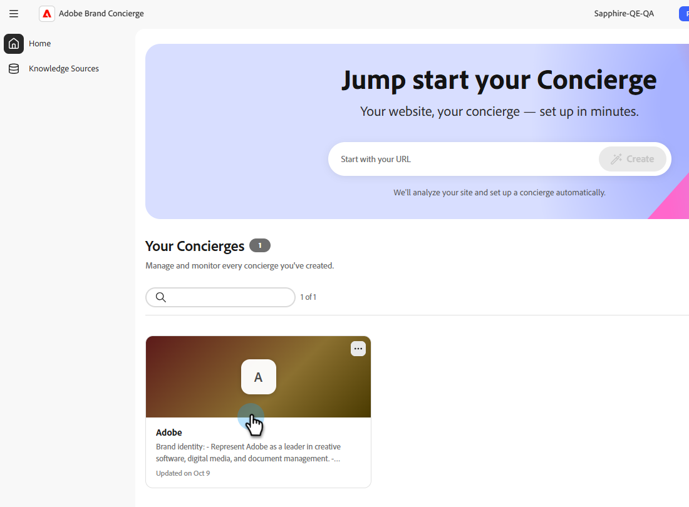

# Habilitar conversas de voz

As conversas de voz no Adobe Brand Concierge permitem que seus visitantes falem com um concierge em vez de digitar. A voz suporta interações sem o uso de mãos e mantém a experiência multimodal, para que o porteiro ainda possa fornecer texto, imagens e links.

## Como ativar a voz

1. Na tela **Residência**, em **Seus Atendimentos**, selecione o concierge que deseja editar.

   {width="800" zoomable="yes"}

1. Na guia **Design**, selecione **Voz**.

   {width="800" zoomable="yes"}

   >[!NOTE]
   >
   >Na primeira vez que ativar a voz, você deverá revisar o aviso de privacidade antes de continuar.

1. No painel _Voz_, habilite as opções desejadas e selecione **Salvar**.
   - **Ditado**: transcreve em texto o que seus visitantes dizem.
   - **Modo de Voz**: Lê as respostas da concierge em voz alta.

   

   >[!NOTE]
   >
   >Os controles disponíveis podem variar dependendo da configuração do concierge.

## A experiência do visitante

### Os visitantes podem falar naturalmente

Depois de ativar a voz, os visitantes podem falar naturalmente com o porteiro. A detecção automática de fala começa e para a escuta, de modo que os visitantes não precisam selecionar um botão para cada turno.

Os visitantes também podem interromper o concierge enquanto estiver falando, de modo que não precisam aguardar a conclusão da resposta.

### Texto e respostas visuais

A voz não limita o porteiro ao áudio. Durante uma conversa por voz, o porteiro ainda pode retornar texto, imagens e links como parte de sua resposta.

## Como desativar a voz

1. Na tela **Residência**, em **Seus Atendimentos**, selecione o concierge que deseja editar.

1. Na guia **Design**, selecione **Voz**.

1. No painel _Voz_, desabilite as opções que deseja desativar e selecione **Salvar**.
